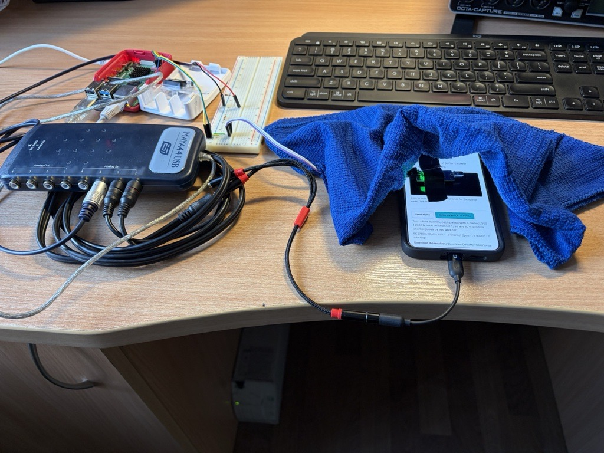
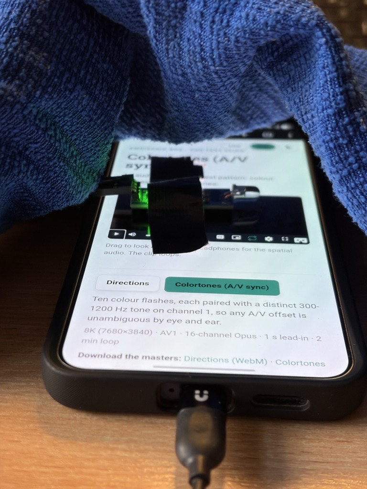

# Acoustic A/V offset harness

Measures the offset between the sound leaving a Mac and the frame painted by the player, in Chrome, Safari and Firefox. The results and what they mean are in [RESULTS.md](RESULTS.md); this page is how to repeat them. macOS only: the sound is recorded through a CoreAudio loopback device.

## What you need

- macOS with [BlackHole 2ch](https://existential.audio/blackhole/) installed, and the Mac's sound output set to it. Nothing else may play while a run records.
- `ffmpeg` with libx264 and libopus, `swiftc` (Xcode command line tools), Node.js, and `python3` with numpy.
- `npm ci` in the repository root (Playwright's `playwright-core` drives Chromium browsers; it does not download one, so the browsers below must be installed).
- Browsers as needed: Google Chrome (the stable build), Google Chrome Canary, Safari, Firefox (the results used Beta 161 and Nightly 163). Safari needs Develop, Allow Remote Automation, and `safaridriver --enable` once. Firefox needs `geckodriver` on the path.
- Network access to the production site: the harness loads the real on-demand page from `stream.bmroz.eu` through a local proxy and swaps in the test clips. Set `BASE` to measure another deployment that serves the `colortones` clip.

## Run

```bash
cd lipsync-acoustic-test
swiftc -O cap.swift -o cap
./make-fixtures.sh
PY=/path/to/python-with-numpy ./run-matrix.sh my-run
```

`run-matrix.sh <prefix> [engine ...]` measures every clip in each engine (`chrome`, `canary`, `canaryKS` for Canary with the empty edit skipped, `safari`, `firefox`, and `firefoxNightly`, which starts `/Applications/Firefox Nightly.app` (set `FIREFOX_NIGHTLY` for another path); default is the first three plus Safari), about a minute per run, and appends one line per run to `runs/results.tsv`. The columns are the run tag, the browser version, the clip, the player build, the number of pairs, the offset (mean, sd, min, max in ms), the calibration spread, the feed's own shift, and what the feed measured of the engine.

Useful variables: `CLIPS="trim live"` to run only some clips, `BUNDLE=/path/to/hoast360.bundle.js` to test a player build other than the deployed one, `DEVICE` for another capture device, `DUR` for the seconds played per run (default 40).

A single run by hand: `node measure.cjs <tag> "<browser executable>" <clip>` for Chromium, `node measure-wd.mjs <tag> <safari|firefox> <clip>` for the others, then `python3 analyze.py <tag>`.

## Files

| File | Purpose |
|---|---|
| `make-fixtures.sh` | the five test clips, `fx-<name>/` (not committed; regenerated byte for byte) |
| `set-elst.py` | rewrites the video track's edit list in an fMP4 init segment |
| `measure.cjs` | one run in a Chromium browser (Playwright) |
| `measure-wd.mjs`, `proxy.mjs` | one run in Safari or Firefox (WebDriver), and the local proxy that serves the clips |
| `page-probes.cjs` | the two page-side probes: frame luma, and the calibration clicks |
| `cap.swift` | the CoreAudio recorder (build it to `cap`; not committed; `screencap` likewise) |
| `analyze.py` | pairs beeps with flashes, timing each flash from the frames' media time, and prints one result line |
| `screencap.swift`, `screen-check.sh`, `analyze-screen.py` | a check that does not ask the browser: records the screen and the system audio with ScreenCaptureKit while the usual runs play, and times the flash from the captured picture. Needs Screen Recording permission for the terminal app that runs it |
| `run-matrix.sh` | all engines and clips in one go |
| `results.tsv` | the raw lines behind [RESULTS.md](RESULTS.md) |
| `results-first-clips.tsv` | the first round, superseded: its clips were flawed (see Limits in RESULTS.md) |
| `plot-offsets.py` | draws `offsets.png` and `offsets.svg` from `results.tsv` (needs matplotlib) |

## The photodiode rig

Times a real device's screen and sound with nothing from the device itself: a photodiode on the screen and the device's sound output, recorded together by one sound card on a Raspberry Pi. Used on an Android phone, on this Mac's built-in display and on an external monitor (results in [RESULTS.md](RESULTS.md#part-2-at-the-screen-by-the-photodiode-rig)).



*The rig as used on 2026-11-27. Left to right: the Raspberry Pi 4 (red case), the breadboard with the 10 kΩ / 10 kΩ divider, the Maya44 USB with the RCA leads, and the Galaxy S25 under a cloth, its sound taken from a USB-C audio adapter through a headphone and microphone splitter.*



*The sensor module taped over the player's video area. The board's own green power LED still shows here; the indicator LED next to the photodiode was taped over after this photo, as described below. The page is in light mode in this photo; dark mode keeps the screen around the video dark.*

- **Light:** an LM393 light sensor module, powered from the Pi's 3.3 V (physical pin 1) and ground (pin 9 on the rig used; pin 6 was taken by the case fan). Its analog output (AO) goes through a 10 kΩ / 10 kΩ divider into a line input. Tape over its indicator LED, which otherwise shines on the photodiode during each flash, and tape the module over the video, covered from room light. The input blocks steady voltage, so each change of light shows as a spike, one polarity for white and the other for black.
- **Sound:** the phone's USB-C audio adapter, its headphone side into two line inputs. On the setup used: Maya44 USB input 1 = phone right, 2 = phone left, 3 = photodiode. Phone media volume 10 of 15 (15 clips the input).
- **Phone control:** Chrome on the phone over its DevTools socket, through wireless debugging (the USB port carries the audio adapter): `adb pair`/`adb connect` (the pairing port shows in `adb mdns services`), then `adb forward tcp:9222 localabstract:chrome_devtools_remote`. The page is served by the same proxy as the Mac runs, reached from the phone through `adb reverse`. Playback starts with a real touch (`Input.dispatchTouchEvent`), which unmuted Web Audio needs. Set the phone's screen timeout longer than a run.

| File | Purpose |
|---|---|
| `measure-android.mjs` | one run on the phone: `ADB_SERIAL=<ip:port> node measure-android.mjs <tag> <clip>`; records on the Pi (`PI`, `PI_CARD`) and copies the recording to `runs/<tag>.rig.wav` |
| `analyze-rig.py` | offset from the photodiode and the left channel; prints one line |
| `rig/diag.cjs`, `rig/www/diag.html` | a Web Audio beep and a page-painted flash due together by Chrome's clocks, to separate the display path from the video element |
| `rig/echo.cjs`, `rig/www/echo.html` | audio round trip: the Pi clicks into the phone's microphone input (Maya out 1/2) and into input 4 as a reference (out 4 to in 4), and the page echoes the microphone to the output |
| `rig/mac-run.sh` | one run of the player on a Mac: `rig/mac-run.sh <tag> <chrome\|canary\|safari\|firefox> <clip>`; `WIN` places the window so that the video box covers the sensor |
| `rig/mac-native.cjs`, `rig/mac-native-wd.mjs`, `rig/www/native.html` | the browser's own playback of a plain MP4 (`rig/www/native.mp4`), in Chromium and through WebDriver, for comparison with the player |
| `rig/mac-diag.cjs` | the bare flash-and-beep page on a Mac |
| `rig-results.tsv` | every rig run behind the results, with the LED check |

**Checking the rig's own timing.** Drive an LED from a Pi GPIO pin (GPIO17, physical pin 11, through 330 Ω to the LED and on to ground) and feed the same pin through a second 10 kΩ / 10 kΩ divider into input 4 as the electrical reference, with the photodiode facing the LED and both covered. Switch the pin with `pinctrl set 17 op dh` / `op dl` while the Pi records: on the rig used, the light's edge came 0.6 ms after the electrical one, so the rig adds nothing that matters at this scale.

