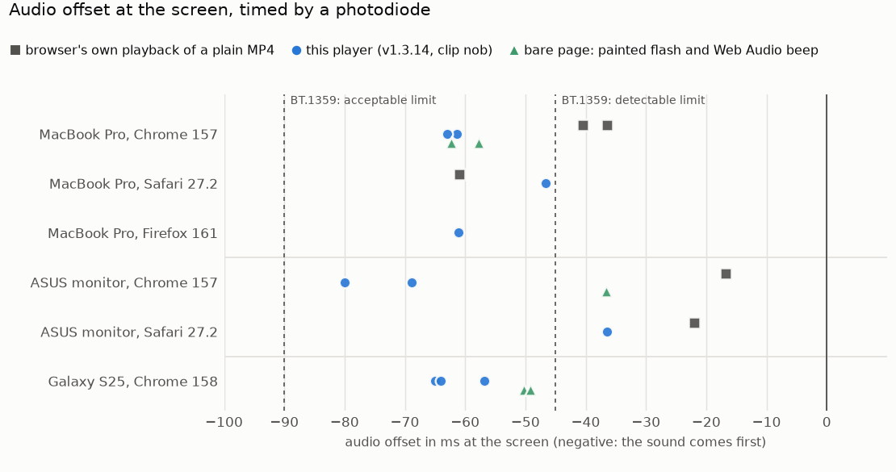

# Sound against picture in the player: by the browser's timing, and at the screen

Date: 2026-11-27

Player: the HOAST360-based player of this repository on its on-demand page, `stream.bmroz.eu/vod/`, releases v1.3.13 and v1.3.14, playing the test clips below

Screens: a MacBook Pro (14-inch, M3 Max), an external monitor and a Galaxy S25

An MP4 video track carries an edit list (`elst`) with up to two kinds of entry: an empty edit, which delays the track's start, and a trim, which drops the first part of the decoded video. Browsers differ in which of these they apply when the video arrives through Media Source Extensions.

Result:

1. By the browser's timing, v1.3.13 played the sound about 60 ms late against video whose edit list is an ordinary trim, and about 500 ms late against a 0.5 s trim, in the browsers that ignore an empty edit. v1.3.14 removes that error: every clip reads within about 20 ms of zero in Chrome 157, Chrome Canary 160, Safari 27.2 and Firefox, except that 2 of 30 Safari runs read about 60 ms early. This compares builds, clips and browsers on one machine. It is not the offset a viewer gets.
2. At the screen, timed by a photodiode, the sound comes before the picture in every case tried. The browsers' own playback of a plain MP4 read 17 to 61 ms early, and this player 37 to 80 ms early, depending on the screen and the browser. The browser's timing does not include that delay, and on the devices tried it gave the page no way to read it.

## The question

The player decodes the 16-channel Opus audio itself and schedules it on the page's audio clock (the audio feed, below), because no browser decodes it natively everywhere. The picture comes from the browser's own video pipeline. They line up only if the page shifts the audio by the offset the browser does not apply to the picture, and that depends on how the browser reads the edit list. A check that reads only the page's own clocks cannot see an error here, because those clocks agree with each other however the edit list is read.

Offset everywhere on this page = time of the beep minus time of the flash, in milliseconds. **Positive means the audio is late**, negative that the sound comes first. Ten flash and beep pairs per run.

## The two instruments

| | Browser timing (Part 1) | Photodiode rig (Part 2) |
|---|---|---|
| Picture timed by | the browser's report of when each frame is shown (`requestVideoFrameCallback`) | a photodiode taped to the screen |
| Sound timed by | a recording of the system output through a loopback device, linked to the page's clock by calibration clicks | the headphone output, recorded on the same sound card as the photodiode |
| Trusts the device for | the frame's display time | nothing |
| Good for | differences between builds, clips and browsers larger than about 30 ms; the ten pairs of one run agree to a few ms | the offset a viewer gets on one screen |
| Runs | all five clips, six browser configurations, two builds | the reference clip, three screens |

## Part 1: the edit-list defect, by the browser's timing

### Method

The setup below is called the harness on the rest of this page.

- **Sound:** the Mac's system output is BlackHole 2ch, a loopback device, recorded by `cap`, a small CoreAudio recorder in this folder (sample-accurate). ffmpeg's avfoundation capture drops about 20 percent of samples and cannot be used for this.
- **Picture:** `requestVideoFrameCallback` on the player's video element gives, for each painted frame, its mean luma, its media time and a display time. Safari reports `expectedDisplayTime` on another clock, so there the callback time is used.
- **Flash time:** taken from the frames' media time. The flash's place in the 4 s slot is the earliest media time at which a flash was seen to start or end at least twice in the run, and media time is mapped to the page clock by the median of (frame time minus media time) over the frames within 1 s. Timing by the first callback that shows a bright frame is one frame late whenever the browser delivers no callback for that frame, which Firefox did for about half of the flashes; `results.tsv` keeps that time as `first_callback`.
- **Clock link:** three 3 kHz clicks, scheduled on an AudioContext at known output times. Their onsets in the recording map the recording's clock to the page's clock.
- **Pairing:** the slots repeat every 4 s, so an offset is only defined modulo 4 s. Each beep is paired with the nearest flash within 2 s.
- **Clips:** five 44 s DASH clips made by [`make-fixtures.sh`](make-fixtures.sh), identical except for the video track's edit list. Flash and beep present together at 2.7 + 4k s (2.7193 + 4k s in `live`, where the flash can only land on a frame and the beep is placed to match). Each clip was decoded and checked: every beep starts on the sample asked for and every flash on the frame asked for.

| Clip | Edit list of the video track | Why it is there |
|---|---|---|
| `nob` | one entry that trims nothing (no B-frames) | reference |
| `ctrl` | a 67 ms trim | what ffmpeg writes for any B-frame video |
| `trim` | one 0.5 s trim, no empty edit | the shape that exposed the v1.3.13 defect |
| `live` | a 53 ms empty edit, then the 67 ms trim | the live stream's list |
| `elst` | a 1.7 s empty edit, then the 67 ms trim | the 1.7 s empty edit behind the Chromium desync described in [docs/UPSTREAM.md](../docs/UPSTREAM.md) |

- **Engines:** Chrome 157 (ignores an edit list that opens with an empty edit), Chrome Canary 160 (applies it), Canary with `--disable-features=MP4ApplyEmptyEditList` (ignores it), Safari 27.2 (ignores it), Firefox 161 Beta and Firefox 163 Nightly (both apply it, and play Opus natively, so the feed is not involved). Every engine applies a list that is only a trim.
- **Player builds:** v1.3.14 is the deployed player. v1.3.13 is its bundle taken from the release tag and served in place of the deployed one (the harness's `BUNDLE=` option). The player measures at page load what the engine does with each shape of list (`hoast360/dependencies/EmptyEditProbe.js`) and the audio feed shifts accordingly.

### v1.3.13 (before the fix)

| Engine | nob | ctrl 67 ms | trim 0.5 s | live | elst 1.7 s |
|---|---|---|---|---|---|
| Chrome 157 | -10 | **62** | **506** | -7 | -10 |
| Canary 160 | -10 | -9 | -7 | 8 | -11 |
| Canary 160, empty edit skipped | 10 | **60** | **494** | 8 | -10 |
| Safari 27.2 | -6 | **50** | **493** | -5 | -6 |
| Firefox 161 Beta | -14 | -5 | -6 | -14 | -2 |
| Firefox 163 Nightly | -1 | -6 | -15 | -15 | -7 |

The engines that ignore a list opening with an empty edit still apply a list that is only a trim, and the feed took the trim off the audio a second time. In Chrome 157 the ordinary 67 ms trim of B-frame video was therefore about 70 ms later than the reference clip, and a 0.5 s trim about 500 ms later. The live stream was not affected, because its list opens with an empty edit and so falls under the shape the player already handled. v1.3.12 and earlier played the `elst` clip 1610 ms early in Canary, which applies the empty edit that the player assumed every browser ignored (measured with an earlier set of clips, see Limits; `results-first-clips.tsv`).

### v1.3.14 (deployed)

| Engine | nob | ctrl 67 ms | trim 0.5 s | live | elst 1.7 s |
|---|---|---|---|---|---|
| Chrome 157 | -9 | 7 | -10 | -11 | -6 |
| Canary 160 | -7 | -4 | -5 | 18 | -6 |
| Canary 160, empty edit skipped | -6 | -4 | 21 | -11 | -10 |
| Safari 27.2 | -13 | -56 | -14 | -17 | -7 |
| Safari 27.2, repeated | -9 | -9 | -16 | | |
| Firefox 161 Beta | -9 | -6 | -5 | -5 | -4 |
| Firefox 163 Nightly | -8 | -5 | -4 | -4 | 0 |

The table shows one run per cell. The repeated row is a second Safari pass over three clips, made after the -56 ms reading. Safari was run 30 times in all on this build in the daytime (see Reading).

### Both builds

*Colour is the build and shape is the browser; each dot is one run of ten pairs. Clips are as in the table under Method ([`plot-offsets.py`](plot-offsets.py) draws it from `results.tsv`, as PNG and SVG; the repeated Safari row and the overnight Safari runs are not drawn). The three dots on the right are the `trim` clip in the engines that ignore an empty edit (Chrome 157, Canary with the empty edit skipped, Safari); the axis is broken between 110 and 450 ms so that the rest stay readable.*

### Reading

- v1.3.14 removes the trim-only defect. In the three engines that ignore the empty edit, `trim` went from 493 to 506 ms to between -16 and 21 ms, and `ctrl` from 50 to 62 ms to between -56 and 7 ms. In each engine both clips now read like that engine's reference clip, apart from one Safari `ctrl` run (below).
- Nothing that was right in v1.3.13 got worse. `nob`, `elst` and `live` read alike in the two builds.
- Firefox, which plays the audio natively, reads 0 to 15 ms early, like Chrome. By the first-callback time it would read 18 to 31 ms early, because its frame callback skipped the first bright frame in 1 to 7 flashes of 10.
- Safari's offset is fixed for the length of a playback (the ten pairs of a run agree to within a few ms) but can change between playbacks. In the daytime 28 of 30 runs on v1.3.14 read -4 to -17 ms, and two `ctrl` runs read -56 and -64 ms, each steady for the whole playback. Both came from runs without a screen recording (2 of 16); 14 runs with a screen recording, nine of them `ctrl`, had none. Six of those 14 are the screen-check runs described below, which have no row in `results.tsv`. Whether the screen recording prevents the odd state or the difference is chance is not known, and the state has not been caught on the photodiode rig, which would show whether a viewer sees it.
- Checks on the page had passed on v1.3.13 while the sound was late at the output. Its probe of the engine tested the empty edit only, and the page's clocks agreed with each other.
- These numbers stop at the browser's report of when a frame is shown. A screen recording made on the same Mac ([`screen-check.sh`](screen-check.sh), ScreenCaptureKit, picture and system audio on the host clock) read 2 to 13 ms later than the harness in Chrome 157 and Safari 27.2 over all five clips, so it agrees with the browser's report and shares whatever that report leaves out.

## Part 2: at the screen, by the photodiode rig

A photodiode is taped over the video and a Raspberry Pi records it together with the device's headphone output on one sound card (an ESI Maya44 USB). Light and sound share one sample clock, and the offset comes from the recording alone. [`analyze-rig.py`](analyze-rig.py) times each flash at half the height of the photodiode's edge and each beep at half of its 1 kHz envelope. How the rig is built and run is in [README.md](README.md#the-photodiode-rig).

*The rig on 2026-11-27: the Raspberry Pi 4, the divider on a breadboard, the Maya44 USB, and the Galaxy S25 under a cloth with the sensor taped over the player's video area (a close-up is in [README.md](README.md#the-photodiode-rig)).*

The rig's own delay is 0.6 ms. An LED switched by a Pi GPIO pin faced the photodiode, and the same pin went into a spare input as the electrical reference. Over 40 edges in two recordings the light's edge came 0.5 to 0.7 ms after the electrical one. The sound needs no such check: it enters the same card as a line signal.

### What was played

- This player: v1.3.14 with the reference clip `nob`, which has no edit list to apply, so Part 1's defect plays no part here.
- The browser's own playback: a plain MP4 (H.264 and stereo AAC, the same flash and beep) in a bare `<video>` element, unmuted, with nothing of ours in the path.
- A bare page: a white flash painted by the page and a Web Audio beep, due at the same moment by the browser's clocks. Two variants map the audio clock to the page clock, one as the player does (by the reported output latency) and one by `getOutputTimestamp`.

### Results

*Each dot is one run of ten pairs. The dashed lines are the BT.1359 limits for sound ahead of picture (see Against the broadcast recommendation). [`plot-rig.py`](plot-rig.py) draws it from `rig-results.tsv`, as PNG and SVG.*

Each number is one run of ten pairs, in ms. All of them are negative: the sound came first.

| Screen | Browser | Browser's own playback | This player | Bare page |
|---|---|---|---|---|
| MacBook Pro built-in, 120 Hz | Chrome 157 | -40, -36 | -61, -63 | -62, -58 |
| | Safari 27.2 | -61 | -47 | |
| | Firefox 161 | | -61 | |
| ASUS VA24EQSB, external, 75 Hz | Chrome 157 | -17 | -69, -80 | -37 |
| | Safari 27.2 | -22 | -37 | |
| Galaxy S25 (Android 17) | Chrome 158 | | -65, -57, -64 | -50, -49 |

Empty cells were not measured. The bare page's two numbers are the output-latency variant, then the `getOutputTimestamp` one; the ASUS has only the second. In Firefox the player leaves the audio to the browser, so that cell is Firefox's own synchronisation of a DASH stream on our page.

### Reading

- The picture reaches the viewer after the sound on every screen and in every browser tried, by 17 to 80 ms. The browsers' own playback of a plain MP4 does it too (17 to 61 ms), so part of the gap belongs to the browser and the screen, whatever the page.
- Part 1 read this player within about 20 ms of zero on the same MacBook, in the same browsers, on the same clip. The rig reads it 47 to 63 ms early there. The likeliest source of the difference is the time between the moment the browser reports for a frame and the light leaving the panel; it was not measured separately. Part 1 also times the sound at a software loopback and Part 2 at the headphone jack, but a delay in the analogue output would make the sound later and cannot account for it arriving earlier.
- `requestVideoFrameCallback` also reports an `expectedDisplayTime`, and it does not account for the gap. On the S25 it equals the callback time (median 0 ms ahead over 1195 frames). On the MacBook it is one refresh after the callback (8.3 ms at 120 Hz in Chrome 157 and Canary 160, one 60 Hz refresh, 16.7 ms, in Firefox), against a gap of 47 to 63 ms. On the devices tried the page has no value to read the delay from.
- Chrome's own playback read -40 and -36 ms on the MacBook and -17 ms on the ASUS; Safari's read -61 and -22 (one run each except Chrome on the MacBook). If those differences hold on repetition, a fixed delay added to the audio would suit one screen and overshoot on the other, so the player adds none until more screens are measured.
- In Chrome the sound leads the picture by more in this player than in Chrome's own playback: about 25 ms more on the MacBook and 52 to 63 ms more on the ASUS, where Chrome's own playback is a single run. The bare page reads like the player on the MacBook, and on the ASUS between the two, nearer Chrome's own playback. The cause is not established. The player draws the video through WebGL, which is the first thing to test.
- In Safari the player read 14 ms nearer to zero than Safari's own playback on the MacBook and 15 ms further from it on the ASUS. Each cell is one run, and repeated cells elsewhere differ by up to about 10 ms, so one run cannot say whether these differences are real.
- On the S25 the gap is on the picture's side. Chrome reports 16 to 24 ms of output latency there, and the player shifts the sound by that. If the real output latency were zero, a wrong report could explain at most 24 ms of the bare page's 50. An audio round trip (the Pi clicks into the phone's microphone input and a page echoes it out) took 146 ms against the 61 ms Chrome reports for input plus output, so if anything the audio latency is under-reported, which would make the display delay larger still.

## Against the broadcast recommendation

Recommendation ITU-R BT.1359-1 [1] puts the detectability thresholds for sound relative to picture at about +45 ms to -125 ms, and the acceptability thresholds at about +90 ms to -185 ms, on the average, where a positive value means the sound is advanced. This page counts the other way (positive means the sound is late), so in this page's sign the detectability window is -45 ms to +125 ms and the acceptability window is -90 ms to +185 ms.

- At the screen (Part 2), every reading is inside the acceptability window. The browsers' own playback is inside the detectability window on the ASUS (-17, -22) and outside it in Safari on the MacBook (-61). This player read past the -45 ms detectability limit in Chrome on all three screens and in Firefox (-57 to -80). The two Safari readings of the player (-47 on the MacBook, -37 on the ASUS) and Chrome's own playback on the MacBook (-36, -40) are within 10 ms of the limit, which is the spread between repeated runs, so they cannot be placed on either side.
- The v1.3.13 defect (Part 1) moved the sound 60 ms later for the ordinary 67 ms trim and 500 ms later for the 0.5 s trim. v1.3.13 was never measured at the screen. If the two effects add, the 67 ms trim would have landed near zero on the MacBook, and the 0.5 s trim about 440 ms late, far outside the acceptability limit.

The thresholds come from subjective tests on television material (a newsreader, Appendix 2 of the recommendation), so they are a scale for the numbers here; no listening test of this player has been run.

## Limits

- **Spread between runs, Part 1.** Within a run the ten pairs agree to about 2 ms in Chrome and Firefox (standard deviation 0 to 2 ms) and less well in Safari (up to 9 ms). Between runs they do not: outside Safari there is one run per cell, and single cells sit 20 to 30 ms from their neighbours for no reason this harness can name (Canary `live` at 18 ms, Canary with the empty edit skipped `trim` at 21 ms). Differences under about 30 ms between cells are not results. Safari's two runs near -60 ms are 40 to 50 ms from their neighbours and are described under Reading.
- **Spread, Part 2.** Within a run the ten pairs spread more than in Part 1: a standard deviation of 3 to 14 ms for this player, 4 to 5 ms for the browsers' own playback on the ASUS and in Safari, and 14 to 32 ms for Chrome's own playback on the MacBook (one of those runs has a single pair at +54 ms) and for the bare page on the MacBook and the S25. Where a cell was repeated, the runs agree to about 10 ms. Most cells are one run.
- **Part 2 covers one clip and three screens.** Only `nob` was played on the rig, so the edit-list fix itself was verified by the browser's timing alone. The S25 has no reading of Chrome's own playback, and no television or iPhone has been measured.
- **Safari with the display asleep.** The first Safari runs of 2026-11-27 were made between midnight and 6:00 with nobody at the Mac and read -18 to -98 ms on every clip in v1.3.14 by the browser's timing (in v1.3.13, -30 to -40 ms on the three clips its defect does not touch). With the display kept awake the same day they read as in the tables. Run again with the display asleep (confirmed by `system_profiler`), Safari read -34 to -41 ms on four clips of five (`trim` -12), with a wider spread within each run, while Chrome in the same state read -7 and -11 ms. So a sleeping display moves Safari's reading by about 25 ms and not Chrome's. Those runs are in `results.tsv`, marked overnight, and are not in the tables. Run with the display awake.
- **Rig runs that are not used.** In the first S25 runs the sensor module's indicator LED switched on during each flash, next to the photodiode, and moved the measured edge by 15 to 20 ms. It is taped over now. One of those runs (`ctrl`) played with no sound at all: the player's audio feed stayed in "underrun" for the whole playback. It did not recur in eight later runs.
- **The first round's clips were flawed.** On 2026-11-21 and 22 the beeps started 9 and 20 ms late in alternate slots (the tone was switched on per 1024-sample frame), the third flash of every clip started one frame late (a floating-point miss in the flash expression), and the `live` flash was 19 ms late (2.714 s is not on the 30 fps frame grid). Those numbers read about 15 ms too late and are kept only in `results-first-clips.tsv`. They showed the same defect and the same fix.
- **On-demand clips, not the live stream.** The live path serves the same player and the same feed, but this harness plays DASH files it controls. The live list is covered by the `live` clip.
- **Firefox and Safari run through WebDriver**, Chromium through Playwright. The page and the recording are the same.

## Files

- `offsets.png`, `offsets.svg`, `plot-offsets.py`: the figure above and the script that draws it.
- `results.tsv`: one line per run by the browser's timing, the raw record behind Part 1. The `player` column says which build was tested.
- `results-first-clips.tsv`: the first round, measured with the flawed clips and timed by the first callback.
- `rig-offsets.png`, `rig-offsets.svg`, `plot-rig.py`: the Part 2 figure and the script that draws it.
- `rig-results.tsv`: the photodiode rig's runs, the raw record behind Part 2, with the LED check.
- How to run it: [README.md](README.md).

## References

1. Recommendation ITU-R BT.1359-1, *Relative timing of sound and vision for broadcasting* (1998). [PDF](https://www.itu.int/dms_pubrec/itu-r/rec/bt/R-REC-BT.1359-1-199811-I!!PDF-E.pdf)
