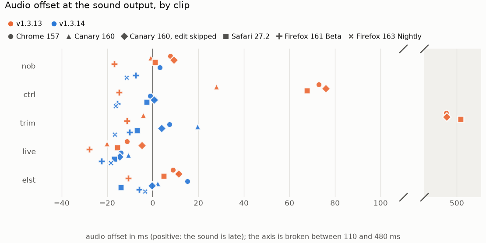
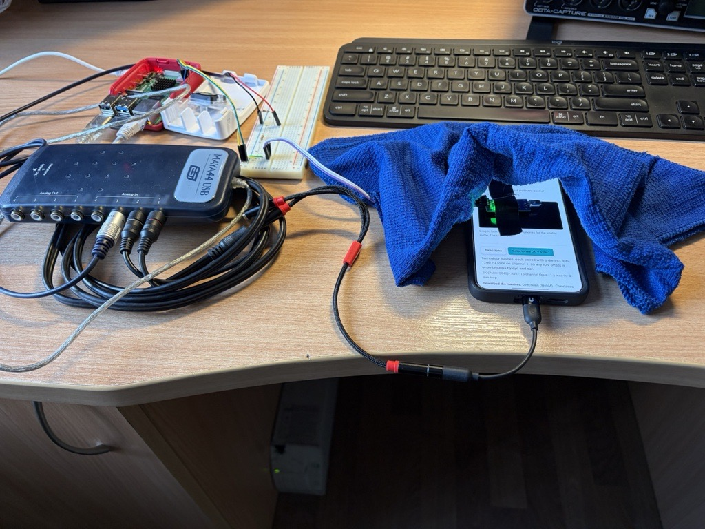

# Audible A/V offset of the player, measured at the system output

**Date:** 2026-11-27 (the numbers on this page; Safari measured again in the daytime, see Limits), after a first round on 2026-11-21 and 22 whose test clips were flawed · **Host:** a Mac with the sound output set to BlackHole 2ch · **Player:** the production on-demand page, `stream.bmroz.eu/vod/?clip=colortones`, with the clip replaced by the test clips below · **Result:** v1.3.13 played the sound about 60 ms late against video with an ordinary trimming edit list, and about 500 ms late against a 0.5 s trim, in the browsers that skip an empty edit. v1.3.14 is within about 20 ms of sync on every clip in Chrome 157, Chrome Canary 160, Safari 27.2 and Firefox, with one Safari run at 56 ms early. A screen recording, which times the picture without asking the browser, agrees.

> **Correction, 2026-11-27 (evening).** The Mac numbers on this page compare the browser's report of when a frame is shown with the sound at the system output, so they are the browser's own timing, not what a viewer sees. They hold for comparing builds, clips and browsers. With a photodiode on the MacBook's screen and the sound from its headphone jack, the same player read -47 to -63 ms (the sound early) in Chrome, Safari and Firefox, and Chrome's own playback of a plain MP4 read -40 ms, so most of that gap is in how late the screen shows a frame, for any page. The rig itself adds 0.6 ms (checked with an LED switched by the Pi); a full write-up follows.

## The question

The player decodes the 16-channel Opus audio itself and schedules it on the page's audio clock, because no browser decodes it natively everywhere. The picture comes from the browser's own video pipeline. They line up only if the page shifts the audio by the offset the browser does not apply to the picture. Browsers differ here: some apply the video track's edit list (`elst`, the MP4 box that carries the track's start offset and trim), others skip part of it. The earlier checks read the page's own clocks. This one compares the sound at the machine's output with the frame as it is painted.

Offset in the tables = time of the beep at the system output minus time of the flash on the video element, in milliseconds. **Positive means the audio is late.** Ten flash and beep pairs per run.

## Method

- **Sound:** the system output is BlackHole 2ch, recorded by `cap` (CoreAudio, sample-accurate). ffmpeg's avfoundation capture drops about 20 percent of samples and cannot be used for this.
- **Picture:** `requestVideoFrameCallback` on the player's video element gives, for each painted frame, its mean luma, its media time and a display time. Safari reports `expectedDisplayTime` on another clock, so there the callback time is used.
- **Flash time:** taken from the frames' media time, not from the first callback that shows a bright frame. The flash's place in the 4 s slot is the earliest media time at which a flash was seen to start or end at least twice in the run, and media time is mapped to the page clock by the median of (frame time minus media time) over the frames within 1 s. The first-callback time is one frame late whenever the browser delivers no callback for that frame, which Firefox did for about half of the flashes; `results.tsv` keeps it as `first_callback`.
- **Clock link:** three 3 kHz clicks, scheduled on an AudioContext at known output times. Their onsets in the recording map the recording's clock to the page's clock.
- **Pairing:** the slots repeat every 4 s, so an offset is only defined modulo 4 s. Each beep is paired with the nearest flash within 2 s.
- **Clips:** five 44 s DASH clips made by [`make-fixtures.sh`](make-fixtures.sh), identical except for the video track's edit list. Flash and beep present together at 2.7 + 4k s (2.7193 + 4k s in `live`, where the flash can only land on a frame and the beep is placed to match). Each clip was decoded and checked: every beep starts on the sample asked for and every flash on the frame asked for.

| Clip | Edit list of the video track | Why it is there |
|---|---|---|
| `nob` | one entry that trims nothing (no B-frames) | reference |
| `ctrl` | a 67 ms trim | what ffmpeg writes for any B-frame video |
| `trim` | one 0.5 s trim, no empty edit | the shape that exposed the v1.3.13 defect |
| `live` | a 53 ms empty edit, then the 67 ms trim | the live stream's list |
| `elst` | a 1.7 s empty edit, then the 67 ms trim | the 1.7 s empty edit behind the Chromium desync described in [docs/UPSTREAM.md](../docs/UPSTREAM.md) |

- **Engines:** Chrome 157 (skips an edit list that opens with an empty edit), Chrome Canary 160 (applies it), Canary with `--disable-features=MP4ApplyEmptyEditList` (skips it), Safari 27.2 (skips it), Firefox 161 Beta and Firefox 163 Nightly (both apply it, and play Opus natively, so the feed is not involved). Every engine applies a list that is only a trim.
- **Player builds:** v1.3.14 is the deployed player. v1.3.13 is its bundle taken from the release tag and served in place of the deployed one (`BUNDLE=`). The player measures at page load what the engine does with each shape of list (`hoast360/dependencies/EmptyEditProbe.js`) and the audio feed shifts accordingly.

## Results

### v1.3.13 (before the fix)

| Engine | nob | ctrl 67 ms | trim 0.5 s | live | elst 1.7 s |
|---|---|---|---|---|---|
| Chrome 157 | -10 | **62** | **506** | -7 | -10 |
| Canary 160 | -10 | -9 | -7 | 8 | -11 |
| Canary 160, empty edit skipped | 10 | **60** | **494** | 8 | -10 |
| Safari 27.2 | -6 | **50** | **493** | -5 | -6 |
| Firefox 161 Beta | -14 | -5 | -6 | -14 | -2 |
| Firefox 163 Nightly | -1 | -6 | -15 | -15 | -7 |

The engines that skip an empty edit still apply a trim, and the feed took the trim off the audio a second time. In Chrome 157 the ordinary 67 ms trim of B-frame video was therefore about 70 ms later than the reference clip, and a 0.5 s trim about 500 ms later. The live stream was not affected, because its list opens with an empty edit and so falls under the shape the player already handled. Before v1.3.13, the `elst` clip played 1610 ms early in Canary, which applies the empty edit that the player assumed every browser skipped (first round, `results-first-clips.tsv`).

### v1.3.14 (deployed)

| Engine | nob | ctrl 67 ms | trim 0.5 s | live | elst 1.7 s |
|---|---|---|---|---|---|
| Chrome 157 | -9 | 7 | -10 | -11 | -6 |
| Canary 160 | -7 | -4 | -5 | 18 | -6 |
| Canary 160, empty edit skipped | -6 | -4 | 21 | -11 | -10 |
| Safari 27.2 | -13 | -56 | -14 | -17 | -7 |
| Safari 27.2, repeated | -9 | -9 | -16 | | |
| Firefox 161 Beta | -9 | -6 | -5 | -5 | -4 |
| Firefox 163 Nightly | -8 | -5 | -4 | -4 | 0 |

### Both builds

*Colour is the build and shape is the browser; each dot is one run of ten pairs. Clips are as in the table under Method ([`plot-offsets.py`](plot-offsets.py) draws it from `results.tsv`, as PNG and SVG; the repeated Safari row and the overnight Safari runs are not drawn). The three dots on the right are the `trim` clip in the engines that skip an empty edit (Chrome 157, Canary with the empty edit skipped, Safari); the axis is broken between 110 and 450 ms so that the rest stay readable.*

## Reading

- v1.3.14 removes the trim-only defect. In the three engines that skip the empty edit, `trim` went from 493 to 506 ms to between -16 and 21 ms, and `ctrl` from 50 to 62 ms to between -56 and 7 ms. In each engine both clips now read like that engine's reference clip, apart from one Safari `ctrl` run (below).
- Nothing that was right in v1.3.13 got worse. `nob`, `elst` and `live` read alike in the two builds.
- Firefox, which plays the audio natively, reads 0 to 15 ms early, like Chrome. By the first-callback time it would read 18 to 31 ms early, because its frame callback skipped the first bright frame in 1 to 7 flashes of 10.
- Safari's offset is fixed for the length of a playback (the ten pairs of a run agree to within a few ms) but can change between playbacks. In the daytime 27 of 29 runs on v1.3.14 read -4 to -17 ms, and two `ctrl` runs read -56 and -64 ms, each steady for the whole playback. Both came from runs without a screen recording (2 of 15); 14 runs with a screen recording, eight of them `ctrl`, had none, and read -5 to 7 ms on screen. Whether the screen recording prevents the odd state or the difference is chance, and whether a viewer would see it, is not known: the only check that would answer it is a camera filming the screen while the sound plays from the speakers. Runs made overnight, with nobody at the Mac and the display probably asleep, read -18 to -98 ms on every clip in both builds; they are in `results.tsv`, marked overnight, and are not in the tables.
- This measurement found the defect; the earlier checks had passed. The v1.3.13 probe tested the empty edit only, and the page's clocks agreed with each other, so both passed while the sound was late at the output.

## On a phone: the photodiode rig

Everything above times the picture by the browser's report or by a screen recording on the same Mac. A phone needs a check that does not trust the device at all, so on 2026-11-27 a photodiode was taped over the video on a Samsung Galaxy S25 (Android 17, Chrome 158, v1.3.14), and a Raspberry Pi recorded it together with the phone's sound output on one sound card (an ESI Maya44 USB). Light and sound then share one sample clock, and the offset comes from the recording alone. How the rig is built and run is in [README.md](README.md#the-photodiode-rig).

*The rig on 2026-11-27: the Raspberry Pi 4, the divider on a breadboard, the Maya44 USB, and the Galaxy S25 under a cloth with the sensor taped over the player's video area (a close-up is in [README.md](README.md#the-photodiode-rig)).*

| Run | Offset (ms) |
|---|---|
| `nob`, three runs | -65, -57, -64 |
| A page-painted white flash and a Web Audio beep, due together by Chrome's clocks (mapped as the player does, and by `getOutputTimestamp`) | -50, -49 |

- The sound comes about 60 ms before the picture on this phone, on the clip without an edit list, so it is not the edit list. That is past the detectability limit of BT.1359 (45 ms early) and inside its acceptability limit (90 ms early).
- It is not the player's latency arithmetic. A bare page that paints and beeps at the same moment by Chrome's own clocks reads -50 ms too; the video element adds about 10 to 15 ms on top.
- The picture is late, not the sound early. Chrome reports 16 to 24 ms of output latency, and the player shifts the sound by that. If the real output latency were zero, a wrong report could explain at most 24 ms, so at least about 25 ms of the page's 50, and about 35 to 40 of the video's 60, is between the page and the light. An audio round trip (the Pi clicks into the phone's microphone input and the page echoes it out) took 146 ms against the 61 ms Chrome reports for input plus output, so if anything the audio is under-reported, which would make the display delay larger still.
- The page cannot correct for it: on this phone the frame callback's `expectedDisplayTime` equals its callback time (median 0 ms ahead over 1195 frames), so Chrome gives no prediction of when the frame is shown. On the Mac, Chrome 157 and Canary 160 put it one refresh (8.3 ms at 120 Hz) after the callback, and Firefox one 60 Hz refresh (16.7 ms).
- Earlier runs that day are not used: the sensor module's indicator LED switched on during each flash, next to the photodiode, and moved the measured edge by 15 to 20 ms. It is taped over now. One of those runs (`ctrl`) played with no sound at all: the player's audio feed stayed in "underrun" for the whole playback. It did not recur in eight later runs.

Raw rows: `rig-results.tsv`.

## Against the broadcast recommendation

Recommendation ITU-R BT.1359-1 [1] puts the detectability thresholds for sound relative to picture at about +45 ms to -125 ms, and the acceptability thresholds at about +90 ms to -185 ms, on the average, where a positive value means the sound is advanced. This page counts the other way (positive means the sound is late), so in this page's sign the detectability window is -45 ms to +125 ms and the acceptability window is -90 ms to +185 ms.

- Every v1.3.14 cell (-17 to 21 ms) is inside the detectability window, except the one Safari `ctrl` run at -56 ms, which is just outside it and inside the acceptability window.
- The ordinary 67 ms trim in v1.3.13 (50 to 62 ms late) was inside the detectability window. The defect was real and measurable, but by this recommendation an average viewer would not have noticed it.
- The 0.5 s trim in v1.3.13 (493 to 506 ms late) is far outside the acceptability limit.

The thresholds come from subjective tests on television material (a newsreader, Appendix 2 of the recommendation), so they are a scale for the numbers here, not a listening test of this player.

## Limits

- **Spread between runs.** Within a run the ten pairs agree to about 2 ms in Chrome and Firefox (standard deviation 0 to 2 ms) and less well in Safari (up to 9 ms). Between runs they do not: there is one run per cell, and single cells sit 20 to 30 ms from their neighbours for no reason this harness can name (Canary `live` at 18 ms, Canary with the empty edit skipped `trim` at 21 ms, Safari `ctrl` at -56 ms). Differences under about 30 ms between cells are not results.
- **Absolute accuracy.** The picture time is the browser's own report of when a frame is displayed, and the sound time is the recording corrected by the click calibration. One check of that does not use the browser's report: [`screen-check.sh`](screen-check.sh) records the screen and the system audio together with ScreenCaptureKit (`screencap.swift`), on the host clock, and [`analyze-screen.py`](analyze-screen.py) times the flash from the captured picture. Over all five clips in Chrome 157 and Safari 27.2 (2026-11-27, v1.3.14) it read 2 to 13 ms later than the harness in the same runs, by about the same amount in both browsers, and Safari -3 to 3 ms. Neither method was checked with a camera and a microphone in a room.
- **Safari with the display asleep.** The first Safari runs of 2026-11-27 were made between midnight and 6:00 with nobody at the Mac and read -18 to -98 ms on every clip in both builds. With the display kept awake the same day they read as in the tables. Run again with the display asleep (confirmed by `system_profiler`), Safari read -34 to -41 ms on four clips of five (`trim` -12), with a wider spread within each run, while Chrome in the same state read -7 and -11 ms. So a sleeping display moves Safari's reading by about 25 ms and not Chrome's; whether Safari's sound or its frame report moves is not known, since nobody watches a sleeping screen. Run with the display awake.
- **The first round's clips were flawed.** On 2026-11-21 and 22 the beeps started 9 and 20 ms late in alternate slots (the tone was switched on per 1024-sample frame), the third flash of every clip started one frame late (a floating-point miss in the flash expression), and the `live` flash was 19 ms late (2.714 s is not on the 30 fps frame grid). Those numbers read about 15 ms too late and are kept only in `results-first-clips.tsv`. They showed the same defect and the same fix.
- **On-demand clips, not the live stream.** The live path serves the same player and the same feed, but this harness plays DASH files it controls. The live list is covered by the `live` clip.
- **Firefox and Safari run through WebDriver**, Chromium through Playwright. The page and the recording are the same.

## Files

- `offsets.png`, `offsets.svg`, `plot-offsets.py`: the figure above and the script that draws it.
- `results.tsv`: one line per run, the raw record behind the tables above. The `player` column says which build was tested.
- `results-first-clips.tsv`: the first round, measured with the flawed clips and timed by the first callback.
- `rig-results.tsv`: the photodiode rig's runs on the Galaxy S25.
- How to run it: [README.md](README.md).

## References

1. Recommendation ITU-R BT.1359-1, *Relative timing of sound and vision for broadcasting* (1998). [PDF](https://www.itu.int/dms_pubrec/itu-r/rec/bt/R-REC-BT.1359-1-199811-I!!PDF-E.pdf)
